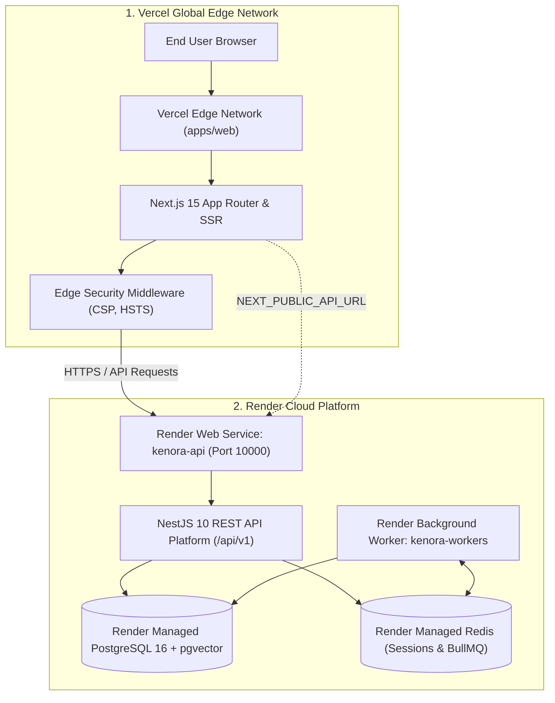

# Production Deployment Guide: Vercel (Frontend) & Render (Backend + DB)

This guide documents the step-by-step procedure for deploying the **Kenora Platform** across a modern hybrid cloud stack:
* **Frontend**: **Vercel** (Global Edge CDN hosting `apps/web`)
* **Backend API & Workers**: **Render** (Node.js Web Service + Background Workers)
* **Databases & Cache**: **Render Managed PostgreSQL** (with `pgvector`) & **Render Redis**

---

## 🌐 Hybrid Deployment Topology



---

## 🚀 Part 1: Deploying Backend & Database on Render

### Step 1: Create a Render Account & Connect Repository
1. Log in to [dashboard.render.com](https://dashboard.render.com).
2. Click **New +** $\rightarrow$ **Blueprint**.
3. Connect your GitHub repository containing Kenora.
4. Render will automatically detect the **[`render.yaml`](../../render.yaml)** file in your repository.

### Step 2: Render Blueprint Auto-Provisioning
The blueprint will declare:
* **`kenora-postgres`**: Managed PostgreSQL 16 database.
* **`kenora-api`**: Web Service running NestJS on port 10000.
* **`kenora-workers`**: Background Worker running BullMQ ingestion processors.

Click **Apply** to provision all services.

### Step 3: Enable `pgvector` on Render PostgreSQL
Once `kenora-postgres` is provisioned:
1. In the Render Dashboard, go to **`kenora-postgres`** $\rightarrow$ **Connect** $\rightarrow$ **External Connection String**.
2. Run the migration command from your local terminal to push schemas and enable `pgvector`:
   ```bash
   # Connect to Render Postgres and enable pgvector
   psql "<RENDER_POSTGRES_EXTERNAL_URL>" -c "CREATE EXTENSION IF NOT EXISTS vector;"

   # Push Drizzle ORM schema tables and HNSW vector indexes
   DATABASE_URL="<RENDER_POSTGRES_EXTERNAL_URL>" pnpm db:push
   ```

### Step 4: Verify API Live Status
After deployment finishes, test your Render API URL (e.g. `https://kenora-api.onrender.com`):
```bash
curl https://kenora-api.onrender.com/api/v1/health
```
You should receive a `200 OK` JSON response:
```json
{
  "success": true,
  "data": { "status": "ok", "version": "0.1.0", ... }
}
```

---

## ⚡ Part 2: Deploying Frontend on Vercel

### Step 1: Import Project to Vercel
1. Log in to [vercel.com](https://vercel.com).
2. Click **Add New...** $\rightarrow$ **Project**.
3. Select your GitHub repository.

### Step 2: Configure Monorepo Settings
In the Vercel Project Configuration screen:
* **Framework Preset**: `Next.js`
* **Root Directory**: Click **Edit** and select `apps/web`.
* **Include files outside the Root Directory**: Toggle to **YES / Checked** (this enables Turborepo to access `@kenora/*` workspace packages).
* **Build Command**: Leave as default or set to:
  ```bash
  cd ../.. && pnpm --filter @kenora/web build
  ```
* **Install Command**:
  ```bash
  pnpm install
  ```

### Step 3: Configure Environment Variables
Add the following environment variables in the Vercel dashboard:

| Variable Name | Value | Purpose |
| :--- | :--- | :--- |
| `NEXT_PUBLIC_API_URL` | `https://kenora-api.onrender.com/api/v1` | Points the frontend client to your Render backend |
| `NODE_ENV` | `production` | Production optimizations |

### Step 4: Deploy
Click **Deploy**. Vercel will build and deploy `apps/web` across its global Edge Network.

---

## 🔒 Part 3: Production Security & CORS Checklist

1. **Configure CORS in Render API**:
   - In `apps/api/src/main.ts`, ensure `app.enableCors()` accepts your Vercel domain:
     ```typescript
     app.enableCors({
       origin: [
         "https://your-kenora-app.vercel.app",
         "http://localhost:3000",
       ],
       credentials: true,
     });
     ```
2. **Set Custom Domain (Optional)**:
   - Frontend: `app.kenora.ai` (CNAME to `cname.vercel-dns.com`).
   - Backend: `api.kenora.ai` (CNAME to Render service hostname).
